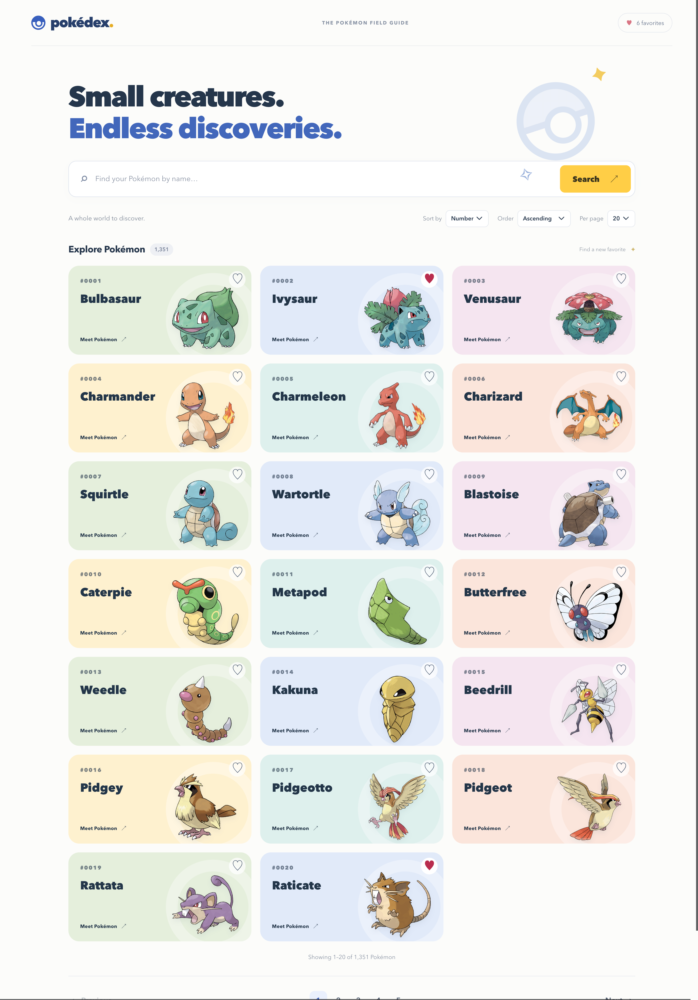
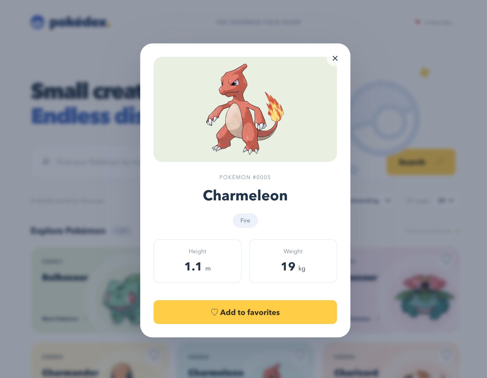

# DearDoc Pokédex

A full-stack Pokédex built for the [DearDoc take-home challenge](https://github.com/DearDoc-Development/fullstack-code-challenge). The React client consumes an Express REST API that wraps PokéAPI; Pokémon JSON requests never go directly from the browser to PokéAPI.

## Implemented features

- Responsive, light-themed grid of horizontal cards with Pokémon names, numbers, and artwork.
- Case-insensitive partial name search, submitted with Search or Enter.
- Sorting by number or name in either direction, pagination, and selectable page size.
- Search, sorting, and pagination synchronized with URL query parameters, including reloads and browser Back/Forward. Changing search, sorting, or page size resets the offset.
- On-demand details dialog with types, height in meters, and weight in kilograms.
- Favorites toggled from cards or details, with a count and browser persistence.
- Loading skeletons, empty results, out-of-range page recovery, and error states with retry actions. Obsolete client requests are aborted.

## Stack and architecture

npm Workspaces monorepo using ES modules and strict TypeScript:

- **Client:** React 19, Vite 8, CSS Modules, typed API services, and custom hooks. No router, component library, or global state library.
- **Server:** Node.js, Express 5, Zod validation, native `fetch`, and in-memory caching. No database or external cache.
- **Tooling:** ESLint, concurrently, Node's built-in test runner; server tests use `tsx` and client tests use Node's TypeScript stripping.

```text
client/
  src/
    components/    # One folder per component, with colocated TSX and CSS Module
    hooks/         # Catalog URL state, requests, and favorites
    services/      # HTTP requests to our backend
    types/         # Frontend domain and API contracts
    App.tsx        # Screen composition
  test/
server/
  src/
    routes/        # HTTP handling and request validation
    services/      # Pokémon operations and separate PokéAPI communication
    cache/         # Cached state, TTL, SWR, and in-flight deduplication
    schemas/       # Request and upstream response validation
    middleware/    # Centralized error responses
    app.ts         # Express application factory
    index.ts       # Server startup
    types.ts       # Backend response contracts
  test/
```

Backend flow: route → Pokémon service → cache → PokéAPI service. The Pokémon service filters, sorts, and paginates; the PokéAPI service fetches, validates, and transforms upstream data. Cache lifecycle stays separate from upstream communication.

## Requirements and setup

- **Node.js 22.23.1** is pinned in `.nvmrc`. The declared supported range is Node `^22.13.0 || >=24`; Node 18 and 23 are outside that range.
- npm with Workspaces support; no other package manager is required.
- A modern browser supporting native `<dialog>`, localStorage, and AbortController.
- Internet access for installing dependencies, fetching uncached Pokémon data, and loading artwork.

Run from the repository root:

```sh
# If using nvm; otherwise install/select Node.js 22.23.1 yourself.
nvm install
nvm use
npm ci
npm run dev
```

`npm ci` installs both workspaces from the root lockfile. `npm install` is an alternative when intentionally updating dependencies.

Open [http://localhost:5173](http://localhost:5173). The API runs at [http://localhost:3001](http://localhost:3001). The root development command runs both applications with concurrently; Ctrl+C stops both. Vite uses port 5173 with `strictPort`, so free that port if it is occupied. Its `/api` proxy targets the Express server on port 3001.

No API key or environment file is required. To customize the backend port:

```sh
cp server/.env.example server/.env
```

Set `PORT` in `server/.env` to an integer from 1 to 65535 (default: `3001`). Node loads this optional file when running the server's development or start script. If changing the API port, update the proxy target in `client/vite.config.ts` too. Environment files are ignored by Git.

## Commands and tests

All commands below run from the repository root:

| Command | Purpose |
| --- | --- |
| `npm run dev` | Run the client and API together with watch/reload behavior |
| `npm run build` | Typecheck/build the client into `client/dist`, then compile the API into `server/dist` |
| `npm run typecheck` | Check application and test TypeScript in both workspaces |
| `npm run lint` | Lint TypeScript with zero warnings allowed |
| `npm run test --workspaces` | Run client and server tests |
| `npm run test --workspace client` | Run frontend service and parsing tests |
| `npm run test --workspace server` | Run backend cache and HTTP API tests |
| `npm run start --workspace server` | Run the compiled API after building |
| `npm run preview --workspace client` | Preview the built client locally after building |

The `dev`, `build`, and `typecheck` scripts can also target either workspace, for example `npm run dev --workspace client`. There is no root `test` or root `start` script.

Automated tests mock upstream requests and do not require live PokéAPI access. Backend tests open temporary localhost ports and cover cache lifecycle/concurrency, malformed upstream data, filtering, sorting, pagination, details, validation, health, and error responses. Client tests cover URL parsing, stored favorite parsing, request encoding, cancellation propagation, and service errors. Rendered components and hook effects do not have automated browser tests.

## REST API

Base URL for local API requests: `http://localhost:3001`. Successful endpoints return JSON directly; errors use the shared shape below.

### `GET /api/health`

Returns HTTP 200:

```json
{ "status": "ok" }
```

This checks that the application responds; it does not check PokéAPI availability.

### `GET /api/pokemon`

| Parameter | Default | Accepted values |
| --- | --- | --- |
| `search` | `""` | Trimmed string; case-insensitive partial name match |
| `sortBy` | `id` | `id` or `name` |
| `order` | `asc` | `asc` or `desc` |
| `limit` | `20` | Integer from 1 to 100 |
| `offset` | `0` | Non-negative safe integer |

Filtering runs across the entire catalog before sorting and pagination. `total` counts all matches before pagination. Sorting does not mutate the cached catalog. Omitted parameters receive defaults; invalid values, repeated parameters, and unknown parameters return HTTP 400. Empty matches or offsets past the results return HTTP 200 with `results: []`.

```sh
curl 'http://localhost:3001/api/pokemon?search=charmander&sortBy=name&order=asc&limit=1&offset=0'
```

Example response (catalog contents and totals depend on upstream data):

```json
{
  "results": [
    {
      "id": 4,
      "name": "charmander",
      "image": "https://raw.githubusercontent.com/PokeAPI/sprites/master/sprites/pokemon/other/official-artwork/4.png"
    }
  ],
  "total": 1,
  "limit": 1,
  "offset": 0
}
```

### `GET /api/pokemon/:nameOrId`

Accepts a Pokémon name or positive safe integer ID. Names are trimmed and lowercased; numeric IDs with leading zeros are normalized. Missing Pokémon return HTTP 404, while invalid parameters return HTTP 400.

```sh
curl http://localhost:3001/api/pokemon/pikachu
# Equivalent lookup:
curl http://localhost:3001/api/pokemon/25
```

Example HTTP 200 response:

```json
{
  "id": 25,
  "name": "pikachu",
  "image": "https://raw.githubusercontent.com/PokeAPI/sprites/master/sprites/pokemon/other/official-artwork/25.png",
  "types": ["electric"],
  "height": 0.4,
  "weight": 6
}
```

Height is converted from decimeters to meters; weight from hectograms to kilograms. Types follow upstream slot order.

### Errors

```json
{
  "error": {
    "code": "POKEMON_NOT_FOUND",
    "message": "Pokémon not found"
  }
}
```

| Status | Meaning / error code |
| --- | --- |
| 400 | Invalid parameters or URL encoding: `INVALID_REQUEST` |
| 404 | Missing Pokémon: `POKEMON_NOT_FOUND`; unknown endpoint: `NOT_FOUND` |
| 500 | Unexpected internal failure: `INTERNAL_ERROR` |
| 502 | Upstream HTTP/network/JSON failure: `UPSTREAM_ERROR`; invalid response data: `INVALID_UPSTREAM_DATA` |
| 503 | PokéAPI returned 429 or 503: `UPSTREAM_UNAVAILABLE` |
| 504 | Upstream request timed out: `UPSTREAM_TIMEOUT` |

Errors are centralized in middleware. Responses omit stack traces; server-side failures are logged with diagnostic context.

## Persistence and caching

**Favorites:** IDs are stored under `deardoc-pokedex-favorites` in localStorage. Favorites survive reloads on the same browser origin, synchronize through storage events across tabs, and can be removed by toggling again. Malformed entries are ignored. Failed writes show a warning and retain changes in memory for the current session. There is no account or server-side favorites storage.

**Catalog cache:** The server discovers PokéAPI's count and requests the full index without fetching every Pokémon's details. Resource URLs, completeness, and uniqueness are validated before accepting a replacement.

- Cold cache: callers wait for one shared load.
- Fresh cache: return immediately, with a **one-hour TTL** measured from the last successful replacement.
- Stale cache: return the previous catalog immediately and start one background refresh (**stale-while-revalidate**).
- A shared in-flight promise deduplicates initial loads and refreshes. A failed refresh logs the error, preserves the valid catalog, and allows a later request to try again. Refreshes are request-triggered; there is no timer or retry delay.
- Each upstream HTTP request, including reading its JSON body, has a **five-second timeout**. A catalog load makes two sequential requests.

**Details cache:** Details load on demand into a `Map` keyed by canonical ID. Concurrent requests for the same ID share an in-flight promise. Only successful, validated results are cached; details have no TTL or eviction policy. Names resolve through the catalog, while numeric IDs bypass the index.

## Limitations and trade-offs

- Caches are process-local and reset on restart. Multiple server instances do not share cached data. The unbounded details cache favors simplicity over memory limits and freshness.
- SWR favors availability: stale catalog data can remain indefinitely during upstream failures, and name lookup may miss newly added entries until refresh succeeds. A count change between catalog requests rejects that refresh instead of publishing an incomplete snapshot.
- Filtering and sorting happen in server memory for each list request. No database, authentication, Redis, or distributed infrastructure is included.
- Card colors are decorative, not type indicators; types appear only in details. Artwork is loaded directly from the public sprites URLs and may be unavailable for some forms.
- Favorites are browser/origin-specific and have no cross-device synchronization or favorites-only view. Clearing site storage removes them.
- This repository provides local development and build commands. Express does not serve the built client; hosting requires a static frontend and same-origin `/api` routing to the API. Vite preview is for local inspection, not production hosting. Cross-browser and accessibility review remain manual.


## Screenshots
### Pokémon catalog


### Pokémon details
